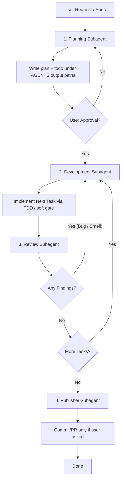

# Multi-Agent Iteration Loop

This skill coordinates four independent agents (`planning`, `development`, `review`, and `publisher`) in a continuous loop to deliver and publish spec-compliant, standard-abiding features.

## Workflow Execution Steps

> [!IMPORTANT]
> **Coordinator Constraint**: The coordinator (host) orchestrates only. During **Development**, do not implement product code in the host — spawn a development subagent. The host still owns user questions, merge order, and the final Close verdict. Map “spawn X subagent” to the host’s Task/subagent tool with a bounded prompt that loads the skill named below.

### 1. Planning Phase
- **Spawn the `planning` subagent** to read the user request/specification and codebase structure.
- The `planning` agent loads [to-tickets](../to-tickets/SKILL.md) for breakdown and blocking edges. If no spec exists yet, the user may run `/to-spec` first; planning may synthesize from conversation when scope is already clear.
- Write plan + checkbox todo under **Where to put outputs** in repo-root `AGENTS.md` (default WIP: `.scratch/agent-loop/plan.md` and `.scratch/agent-loop/todo.md` unless the user names a tracker). Do **not** invent a committed `tasks/` tree unless the product repo already uses one.
- Once the plan is saved, present it to the user for feedback and approval.

### 2. Development Phase (Task Implementation)
- **Select the first incomplete task** from the todo file.
- **Spawn the `development` subagent** to implement that task.
- The `development` agent must load [tdd](../tdd/SKILL.md) and follow product `AGENTS.md` **When behaviour changes**:
  - If a test runner exists for the seam: failing test first → minimal code → real red before green.
  - If no runner for that seam yet: do **not** invent an unexecutable failing test; use the interim quality gate from that product `AGENTS.md` (build/lint as documented). UI uses Vitest (`pnpm test`) when the seam is under test.
  - Verify quality commands in repo-root `AGENTS.md` for this product.
  - Mark the task completed `[x]` in the todo file.

### 3. Review Phase (Quality Gates)
- **Spawn the `review` subagent** to run the Process in [project-code-review](../project-code-review/SKILL.md) on the slice's git diff (pin range → quality commands → four axes with severity → merge blocked yes/no).
- **Evaluate results**:
  - **If merge blocked or any High/Medium finding remains**:
    - Send the review report to the `development` subagent.
    - Instruct the developer to resolve findings; rerun review when the branch updates.
  - **If merge not blocked and no blocking findings**:
    - Check the todo file for the next incomplete task.
    - If tasks remain, loop back to **Step 2**.
    - If all tasks are completed, proceed to **Step 4**.

### 4. Publishing Phase (Deployment Gate)
- **Spawn the `publisher` subagent** (no separate pull-request skill — follow these steps):
  1. `git status`; ensure the slice is green per `AGENTS.md` Close (review Process already run for the last development cycle).
  2. Stage only files for this slice; **do not commit or `gh pr create`** unless the user asked for a commit/PR in this session (local-git / no-`gh` product policies still apply).
  3. If committing: use **Conventional Commits** (`type(scope): subject` — types like `feat`, `fix`, `docs`; subject imperative, ≤72 chars).
  4. Push only when the user asked and a remote is configured: `git push -u origin HEAD`.
  5. Open PR only when asked: `gh pr create --title "..." --body` with Summary (bullets) and Test plan (checklist) — or prepare the body for the user if `gh` is disallowed.
  6. Return the PR URL or the prepared commit/PR text.

## Exit Criteria
- All tasks in the todo file are marked `[x]`.
- `project-code-review` Process completed for the final slice with merge not blocked.
- Quality commands for the product pass (per `AGENTS.md`), including soft gates when no test runner exists.
- When publishing was requested: PR URL or prepared commit/PR materials returned.

## Sub-Agent Skill References

| Role | Load |
|---|---|
| **Planning** | [to-tickets](../to-tickets/SKILL.md) — optional prior `/to-spec` for durable spec |
| **Development** | [tdd](../tdd/SKILL.md) |
| **Review** | [project-code-review](../project-code-review/SKILL.md) |
| **Publisher** | Inline steps in §4 above (Conventional Commits + `gh pr create`) |